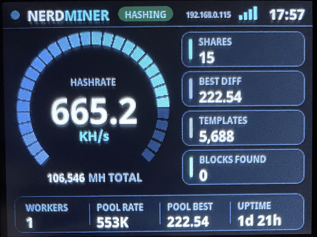

# NerdMiner Modded

**A modded fork of the NerdMiner v2**

This is a modified version of the original **[NerdMiner_v2](https://github.com/BitMaker-hub/NerdMiner_v2)** by BitMaker-hub. All credit for the original project, the Stratum implementation and the multi-board support goes to the original authors and contributors. If you want the stock, widely tested firmware for any of the supported boards, use the original repository.

This is a **free and open source project** that let you try to reach a bitcoin block with a small piece of hardware.

The main aim of this project is to let you **learn more about minery** and to have a beautiful piece of hardware in your desktop.

Original NerdMiner_v2 project https://github.com/BitMaker-hub/NerdMiner_v2
(which itself started from https://github.com/valerio-vaccaro/HAN)

## What's different in this mod



> **⚠️ Tested on four boards only.** The changes in this fork have been developed and tested on the **ESP32-2432S028R (2.8" "Cheap Yellow Display", CYD)**, the **4.0" CYD with the 320x480 ST7796 panel**, the **LilyGO T-Display 1.14"** and a **screenless ESP32-WROOM-32 dev board**. Other boards still build from the same code base as the original, but they have **not** been tested with these changes. Expect rough edges, and please report what you find.

- **High hashrate on the CYD** – the SHA-256 mining path for the classic ESP32 has been reworked to use the hardware SHA engine in a pipelined fashion, giving a sustained rate of roughly **990 KH/s** on the CYD (classic ESP32, both cores mining). Changes to the mining code are validated hash by hash against software, so the extra speed is not coming at the cost of invalid shares.
- **New "Pulse" display theme** – the CYD UI has been completely redesigned. It is bitmap-free and has three screens: **MINE**, **MARKET** and **CLOCK**. Tap the wordmark to cycle the accent colour, and tap the top-right corner to toggle the backlight.
- **4.0" CYD support** – the 4.0" 320x480 ST7796 variant of the CYD (ESP32-WROOM-32E, resistive touch) has its own build, `ESP32-4in-ST7796`: the same mining loop and the Pulse theme laid out for the larger 480x320 screen.
- **Pulse on the LilyGO T-Display 1.14"** – the `TTGO-T-Display` build now uses the Pulse theme laid out for the 240x135 screen, with four screens: **MINE**, **MARKET**, **CLOCK** and **POOL** (workers, pool rate, pool best, uptime, pool and the settings page's IP address). It also frees enough memory for the BTC price, block height and network stats to load; with the old screens most of those requests failed on this board. Double-click the top button (USB on the right) to cycle the accent colour. Brightness, screen timeout, night dimming and display flip are set from the web settings page. See [T-Display 1.14" (Pulse)](#t-display-114-pulse) for the buttons.
- **Headless build for a bare ESP32-WROOM-32** – a dev board without a screen has its own build, `ESP32-WROOM-Headless`: the same mining loop (measured at ~990 KH/s on a revision 3 chip), status on the serial port and the on-board LED. The LED can be switched off from the web settings page.
- **Classic theme still available** – prefer the original look? Build the `ESP32-2432S028R-Classic` environment (`pio run -e ESP32-2432S028R-Classic -t upload`), or `TTGO-T-Display-Classic` on the T-Display 1.14".
- **BTC price in your currency** – choose which fiat currency the BTC price is shown in from the web settings page.
- **Improved web settings page** – the settings page stays reachable while mining, and now also has options for display flip (USB on the left), colour inversion, brightness and currency. Changes apply without a restart, including switching pool or wallet; only colour inversion and display flip restart the device. See [Web settings page](#web-settings-page) for how to log in. The page also takes a backup pool, a password of your own, and serves the miner's state as JSON at `/api/status`.
- **Screen timeout and night dimming** – on the boards with a touch screen, and on the T-Display 1.14", the backlight can switch off after a set number of minutes without a touch, and fade down to a night level around sunset (and back up at sunrise) for the city or coordinates you pick. Both are set from the web settings page.

### Why this hashrate is real

The ~990 KH/s is what the miner actually hashes, not what a counter says:

- **Hardware limit** – the classic ESP32's SHA engine can't be loaded with an external midstate, so every nonce costs three hardware hash blocks plus two engine loads: about 228 CPU cycles of engine time, a ceiling of roughly 1.05 MH/s at 240 MHz. The mining loop keeps the engine busy for all but ~20 cycles of each nonce (247 cycles per nonce, ~970 KH/s); the second core adds ~35 KH/s in software (a hand-scheduled assembly SHA-256 up to its 16-bit early exit, checked on the chip against mbedTLS on 2.8 million nonces).
- **Measured on the chip** – the loop's timing comes from an on-device bench (`-D SHA_BENCH`, see `src/sha_bench.cpp`) that checks every single hash against software, also while the other core hammers the peripheral bus. That is how the hardware quirk behind silently corrupted hashes in the usual pipelined loops was found: writes to the SHA registers less than three cycles apart can be dropped whenever the other core is using the same bus.
- **Only valid hashes are counted** – every candidate the hardware finds is recomputed in software before it is used. A hashrate counter on its own can look faster after an optimisation while the miner is quietly producing *fewer* valid shares, because corrupted hashes are still counted; here the firmware checks itself with a known-answer test at power-on and falls back to a slower loop (first one with two more cycles on every delay, ~930 KH/s) if the fast one ever gets hashes wrong.
- **The rate is the rate it actually mines at** – it's the sustained average over a long run, not a short burst or a best-case peak.

If a number sounds too good for this chip, check whether the shares it finds actually keep up with it.

For the other features, supported boards, flashing and configuration, the original documentation below still applies.

## Requirements

- TTGO T-Display S3 or any supported boards (check Build tutorial 👇)
- 3D BOX [here](3d_files/)

### Project description

**ESP32 implementing Stratum protocol** to mine on solo pool. Pool can be changed but originally works with [public-pool.io](https://web.public-pool.io) (where Nerdminers are supported).

This project was initialy developed using ESP32-S3, but currently support other boards. It uses WifiManager to modify miner settings and save them to SPIFF.
The microMiner comes with several screens to monitor it's working procedure and also to show you network mining stats.
Currently includes:

- NerdMiner Screen > Mining data of Nerdminer
- ClockMiner Screen > Fashion style clock miner
- GlobalStats Screen > Global minery stats and relevant data

This miner is multicore and multithreads, both cores are used to mine and several threads are used to implementing stratum work and wifi stuff.
Every time an stratum job notification is received miner update its current work to not create stale shares.

**IMPORTANT** Miner is not seen by all standard pools due to its low share difficulty. You can check miner work remotely using specific pools specified down or seeing logs via UART.

**_Current project is still in developement and more features will be added_**

## Build Tutorial

### Hardware requirements

- LILYGO T-Display S3 (original one) or any other supported boards
- 3D BOX [here](3d_files/)

#### Current Supported Boards

- LILYGO T-Display S3 ([Aliexpress link\*](https://s.click.aliexpress.com/e/_Ddy7739))
- ESP32-WROOM-32, ESP32-Devkit1.. ([Aliexpress link\*](https://s.click.aliexpress.com/e/_DCzlUiX)) (fast mining loop: build environment `ESP32-WROOM-Headless`)
- LILYGO T-QT pro ([Aliexpress link\*](https://s.click.aliexpress.com/e/_DBQIr43))
- LILYGO T-Display 1.14 ([Aliexpress link\*](https://s.click.aliexpress.com/e/_DEqGvSJ)) (Pulse theme: build environment `TTGO-T-Display`, original look: `TTGO-T-Display-Classic`)
- LILYGO T-Display S3 AMOLED ([Aliexpress link\*](https://s.click.aliexpress.com/e/_DmOIK6j))
- LILYGO T-Display S3 AMOLED Touch ([Board Info](https://www.lilygo.cc/products/t-display-s3-amoled?variant=43532279939253))
- LILYGO T-Dongle S3 ([Aliexpress link\*](https://s.click.aliexpress.com/e/_DmQCPyj))
- ESP32-2432S028R 2,8" ([Aliexpress link\*](https://s.click.aliexpress.com/e/_DdXkvLv) / Dev support: @nitroxgas / ⚡jadeddonald78@walletofsatoshi.com)
- 4.0" CYD, 320x480 ST7796 (ESP32-WROOM-32E, build environment `ESP32-4in-ST7796`)
- ESP32-cam ([Board Info](https://lastminuteengineers.com/getting-started-with-esp32-cam/) / Dev support: @elmo128)
- M5-StampS3 ([Aliexpress link\*](https://s.click.aliexpress.com/e/_DevABY3) / Dev support: @gyengus)
- Wemos Lolin S3 Mini ([Board Info](https://docs.platformio.org/en/latest/boards/espressif32/lolin_s3_mini.html))
- Wemos Lolin S2 Mini ([Board Info](https://docs.platformio.org/en/latest/boards/espressif32/lolin_s2_mini.html))
- Weact S3 Mini ([Board Info](https://github.com/WeActStudio/WeActStudio.ESP32S3-MINI))
- Weact ESP32-D0WD-V3 ([Board Info](https://github.com/WeActStudio/WeActStudio.ESP32CoreBoard))
- ESP32-S3 Devkit ([Board Info](https://docs.platformio.org/en/latest/boards/espressif32/esp32-s3-devkitm-1.html))
- ESP32-C3 Devkit ([Board Info](https://docs.platformio.org/en/latest/boards/espressif32/esp32-c3-devkitm-1.html))
- ESP32-C3 Super Mini ([Board Info](https://docs.platformio.org/en/latest/boards/espressif32/seeed_xiao_esp32c3.html))
- Waveshare ESP32-S3-GEEK ([Board Info](https://www.waveshare.com/wiki/ESP32-S3-GEEK))
- LILYGO T-HMI ([Aliexpress link\*](https://s.click.aliexpress.com/e/_oFII4s2)) / Dev support: @cosmicpsyop
- ESP32-C3 0.42 Inch OLED ([Aliexpress link\*](https://s.click.aliexpress.com/e/_oDmT4Id) / Dev support: @mrthiti / ⚡ wallet@thiti.dev)
- ESP32-S3 0.42 Inch OLED ([Aliexpress link\*](https://s.click.aliexpress.com/e/_oFIMUoh) / Dev support: @mrthiti / ⚡ wallet@thiti.dev)
- M5StickC Plus2 (ESP32-PICO-V3-02, build environment `M5Stick-C-Plus2`, see [M5StickC Plus2 notes](#m5stickc-plus2))

\*Affiliate links

### Flash firmware

> **Flashing NerdMiner Modded:** use the web flasher at **https://henryscat.github.io/NerdMiner-Modded/** (Chrome, Edge or Brave). It offers a *full install* (factory image: bootloader, partition table and firmware, for a first flash) and a *firmware-only update* (keeps your settings). Pick your board there first: the 2.8" CYD (ESP32-2432S028R), the 4.0" CYD (320x480 ST7796) or the ESP32-WROOM-32 without a screen. You can also build and flash this repository with PlatformIO, e.g. `pio run -e ESP32-2432S028R -t upload` for the 2.8" board, `pio run -e ESP32-4in-ST7796 -t upload` for the 4.0" one or `pio run -e ESP32-WROOM-Headless -t upload` for the screenless board.
>
> The online flasher and the prebuilt binaries in the sections below come from the **original** project and will install the original firmware, not the modded one.

#### microMiners Flashtool [Recommended]

Easyiest way to flash firmware. Build your own miner using the folowing firwmare flash tool:

1. Get a TTGO T-display S3 or any other supported board
1. Go to NM2 flasher online: https://flasher.bitronics.store/ (recommend via Google Chrome incognito mode)

#### Standard tool

Create your own miner using the online firwmare flash tool **ESPtool** and one of the **binary files** that you will find in the `bin` folder.
If you want you can compile the entire project using Arduino, PlatformIO or Expressif IDF.

1. Get a TTGO T-display S3 or any supported board
1. Download this repository
1. Go to ESPtool online: https://espressif.github.io/esptool-js/
1. Load the firmware with the binary from one of the sub-folders of `bin` corresponding to your board.
1. Plug your board and select each file from the sub-folder (`.bin` files).

### Update firmware

Update NerdMiner firmware following same flashing steps but only using the file 0x10000_firmware.bin.

#### Build troubleshooting

1. Online [ESP Tool](https://espressif.github.io/esptool-js/) works with chrome, chromium, brave
1. ESPtool recommendations: use 115200bps
1. Build errors > If during firmware download upload stops, it's recommended to enter the board in boot mode. Unplug cable, hold right bottom button and then plug cable. Try programming
1. In extreme case you can "Erase all flash" on ESPtool to clean all current configuration before uploading firmware. There has been cases that experimented Wifi failures until this was made.
1. In case of ESP32-WROOM Boards, could be necessary to put your board on boot mode. Hold boot button, press reset button and then program.

## NerdMiner configuration

After programming, you will only need to setup your Wifi and BTC address.

Note: when BTC address of your selected wallet is not provided, mining will not be started.

#### Wifi Accesspoint


1. Connect to NerdMinerAP
   - AP: NerdMinerAP
   - PASS: MineYourCoins
1. Set up your Wifi Network
1. Add your BTC address
1. Change the password if needed

   - If you are using public-pool.io and you want to set a custom name to your worker you can append a string with format _.yourworkername_ to the address


#### Live web monitor

`http://<miner IP address>/` shows the miner live in any browser on the same network, phone or computer, no login needed: hashrate with a graph of the last hour, 32-bit shares, best difficulty, pool shares, mining time, BTC price and block height, clock, WiFi signal, pool, and on the M5StickC Plus2 the battery. It refreshes by itself every 3 s, follows the light/dark theme of the device and needs no internet access (everything is served by the miner). Like `/api/status` it shows nothing secret (no wallet address, no password). The graph's history is also available as JSON at `/api/history` (one value every 30 s, KH/s).

#### Web settings page

Once the miner is on your Wifi network it serves a settings page, also while it is mining, so you can change the pool, wallet, timezone, currency and display options without going back to the setup access point. On boards with a touch screen (CYD, 4" CYD, ES3C35P) and on the T-Display 1.14" it can also turn the screen off after a set number of minutes without a touch or button press; any touch or button press wakes it again. On a board without a screen the page has a **Status LED** option instead of the display options, to switch the blinking LED off. On the CYD the RGB LED on the back can be switched off or set to any colour, see [LED on the back](#led-on-the-back-cyd).

1. Open `http://<miner IP address>/settings` in a browser on the same network (`http://<miner IP address>/` is the [live monitor](#live-web-monitor), with a link to the settings). On the CYD the IP address is shown at the top of the screen, on the T-Display 1.14" on its POOL screen; it is also printed on the serial log at start-up and listed by your router.
1. Log in when the browser asks:
   - User: admin
   - Password: MineYourCoins, until you set your own at the bottom of the page (type it twice). If you forget it, a long press of the BOOT button erases the whole configuration (WiFi, pool, all settings and the saved statistics) and with it the password; set the miner up again through its setup access point.
1. Change what you need and press **Save**. The new settings apply straight away, without a restart: a new pool, port, wallet or pool password makes the miner drop the old pool and connect to the new one, and timezone, currency and brightness change on screen within a second or so. Only changing colour inversion or display flip restarts the miner; the page then waits and comes back by itself.

Note: until you change it, the login is the same on every miner (the password is the one of the setup access point), and the page is plain HTTP either way, so only use it on a network you trust.

##### Backup pool

Fill in **Backup pool URL**, port and (optionally) password to have the miner carry on somewhere else while your pool is down. It uses the same BTC address. After three failed attempts in a row on the main pool it moves to the backup; while there it checks every 10 minutes whether the main pool takes a connection again and goes back as soon as it does. If the backup fails too, it goes back to trying the main pool. The settings page says which pool is in use, and so does the status endpoint below. Leave the URL empty for no backup.

##### Status endpoint

`http://<miner IP address>/api/status` returns the miner's state as JSON, for Home Assistant, Grafana or your own scripts. It needs no login and holds nothing the screen doesn't show (no wallet address, no passwords):

```json
{"version":"V1.5.0","uptime_s":3605,"state":"mining","hashrate_khs":991.2,"hashrate_avg_khs":988.7,
 "total_mhashes":59113,"mining_time_s":60789,"templates":2108,"best_diff":5.26,"shares_32bit":9,
 "blocks_found":0,"shares_accepted":412,"shares_rejected":0,
 "pool":{"address":"btc.heliospool.com","port":3333,"backup":false,"subscribed":true,"difficulty":0.0007},
 "wifi":{"ssid":"MyWifi","rssi":-47,"ip":"192.168.0.115"},"free_heap":117484}
```

`hashrate_khs` is the last 10 seconds, `hashrate_avg_khs` the average since the miner started; `shares_accepted` and `shares_rejected` count the pool's answers since then. `total_mhashes`, `mining_time_s`, `shares_32bit`, `best_diff` and `blocks_found` are the same totals the screen shows (kept across restarts when "Save mining statistics" is on).

##### Night dimming

On the boards with a touch screen, and on the T-Display 1.14", the settings page can also fade the backlight down after dark. Tick **Dim the screen at night**, set a night brightness and a fade length in minutes, and pick the nearest city from the list. A city a few hundred kilometres away is still good to a few minutes; for an exact location choose **Custom** and enter your latitude and longitude in decimal degrees (south and west are negative, e.g. London is 51.51 and -0.13). The backlight then moves between the normal brightness and the night level across a window centred on each crossing: the default 60 minute fade starts 30 minutes before sunset and finishes 30 minutes after, then reverses at sunrise.

The page prints the current sun state and today's sunrise and sunset next to the controls, in the timezone set on the page, so you can check the location is right. Until the clock has been set from the network, or with no location entered, the normal brightness is used.

##### LED on the back (CYD)

The CYD's RGB LED is set from the same page:

- **Off**: never lights.
- **Status** (the default): red while starting up or in setup, blue while connecting, then it blinks the chosen colour while mining.
- **Always on**: the chosen colour all the time.

Pick any colour and a brightness from 1 to 255 (the LED is very bright, so 20-60 is plenty at night). Tick **LED off while the screen is off** to have it go dark whenever the backlight is off, by a touch or the screen timeout.

#### SD card (if available)

1. Format a SD card using Fat32.
1. Create a file named "config.json" in your card's root, containing the the following structure. Adjust the settings to your needs:
```
{
  "SSID": "myWifiSSID",
  "WifiPW": "myWifiPassword",
  "PoolUrl": "public-pool.io",
  "PoolPort": 3333,
  "PoolPassword": "x",
  "BtcWallet": "walletID",
  "Timezone": 2,
  "SaveStats": false
}
```

1. Insert the SD card.
1. Hold down the "reset configurations" button as described below to reset the configurations and/or boot without settings in your nvmemory.
1. Power down to remove the SD card. It is not needed for mining.

#### Pool selection

Recommended low difficulty share pools:

| Pool URL          | Port  | Web URL                    | Status                                                             |
| ----------------- | ----- | -------------------------- | ------------------------------------------------------------------ |
| public-pool.io    | 3333 | https://web.public-pool.io | Open Source Solo Bitcoin Mining Pool supporting open source miners |
| pool.nerdminers.org    | 3333  | https://nerdminers.org     | The official Nerdminer pool site - Mantained by @golden-guy |
| pool.nerdminer.io | 3333  | https://nerdminer.io       | Mantained by CHMEX                                                 |
| pool.pyblock.xyz  | 3333  | https://pool.pyblock.xyz/  | Mantained by curly60e                                              |
| pool.sethforprivacy.com  | 3333  | https://pool.sethforprivacy.com/  | Mantained by @sethforprivacy - public-pool fork      |
| pool.stompi.de  | 3333  | http://web.stompi.de  | Mantained by @odinstar - public-pool fork      |
|pool.solomining.de| 3333  | https://pool.solomining.de/ | Mantained by https://x.com/solo_mining |

Other standard pools not compatible with low difficulty share:

| Pool URL                 | Port | Web URL                                   |
| ------------------------ | ---- | ----------------------------------------- |
| solo.ckpool.org          | 3333 | https://solo.ckpool.org/                  |
| btc.zsolo.bid            | 6057 | https://zsolo.bid/en/btc-solo-mining-pool |
| eu.stratum.slushpool.com | 3333 | https://braiins.com/pool                  |

### Buttons

#### One button devices:

- One click > change screen.
- Double click > change screen orientation.
- Tripple click > turn the screen off and on again.
- Hold 5 seconds > **reset the configurations and reboot** your NerdMiner.

#### Two button devices:

With the USB-C port to the right:

**TOP BUTTON**

- One click > change screen.
- Hold 5 seconds > top right button to **reset the configurations and reboot** your NerdMiner.
- Hold and power up > enter **configuration mode** and edit current config via Wifi. You could change your settings or verify them.

**BOTTOM BUTTON**

- One Click > turn the screen off and on again
- Double click > change orientation (default is USB-C to the right)

#### T-Display 1.14" (Pulse)

The same two buttons, plus:

- **TOP BUTTON** double click > next accent colour (five to choose from; kept across restarts, like the last screen shown).
- The orientation set by the bottom button's double click is kept across restarts too, and is the same setting as **Flip display** on the web settings page.
- While the screen is off (bottom button, or the screen timeout from the settings page), the first press of either button only turns it back on.

#### M5StickC Plus2

Build environment: `M5Stick-C-Plus2` (`pio run -e M5Stick-C-Plus2 -t upload`).

- **Button A** (front, "M5"): one click > screen off/on, double click > rotate 180°.
- **Button B** (right side): one click > next screen, hold 5 s > **reset the configuration and reboot**. Hold it while powering on > **configuration mode**.
- **Power button** (left side): press ~2 s to switch on. Once running, hold 2 s > **power off** (on USB power the stick goes to deep sleep instead; press the power button to wake it up).
- The power-hold latch (GPIO4) is set before `setup()` and pad-latched, so automatic reboots (saving the Wi-Fi config, watchdog...) no longer switch the stick off when it runs on battery.
- **Battery level** (GPIO38) with an icon in the top bar of the miner screen, instead of the chip temperature.
- **Screen brightness, screen off after N minutes and night dimming** from the web settings page (backlight on GPIO27 driven in PWM). When the screen is off, any button press wakes it up.
- **Last screen remembered** across restarts (e.g. keep the clock as the start screen).
- **Share found**: short red LED flash + beep; a found block plays a longer pattern. Turn them off with `-D SHARE_LED=0` / `-D SHARE_BEEP=0` in the `M5Stick-C-Plus2` environment.
- Both cores mine: the fast hardware SHA loop on core 1, a software miner on core 0.
- Info screens (clock, global stats, BTC price) refresh every 5-10 min instead of 1-2 min, and a failed request waits 1 min before the next try: every HTTPS request pauses the hardware miner ~1.5 s. For the best hashrate, stay on the miner screen (it makes no request).
- **Automatic summer/winter time** (EU rules, `-D AUTO_DST_EU=1`): set the timezone to the **winter** UTC offset (France: `1`) on the web page or in the WiFi portal; the hour is added on the last Sunday of March and removed on the last Sunday of October.
- **Clock right at power-on**: the on-board BM8563 RTC gives the time until NTP answers (works without WiFi), and is set again after every NTP sync.
- **Mining stats saved at least every 10 min** (`-D STATS_SAVE_MAX_s=600`; stock firmware: up to every 12 h, so a restart could lose hours of shares and best difficulty), and also right before a power off from the button, a flat-battery power off or a restart from the settings page.
- **Power-cut-proof stats**: two save slots used in turn, each save one record with its own CRC. A power cut in the middle of a save only damages the slot being written; the miner restarts from the other one (the stock format reset every counter to zero in that case). Stats saved by the stock firmware are taken over automatically.
- **Flat battery protection**: on battery, below 3.40 V for 30 s, a "Low battery" message then power off (no brown-out reboot loop). On USB nothing happens. `-D PLUS2_LOW_BATTERY_OFF=0` turns it off.

### Unit tests (no board needed)

`pio test -e native` builds the stratum parsing, the block header code (`calculateMiningData`), the share checks (`checkValid`, `diff_from_target`) and the software SHA-256d for the PC and runs 15 tests in a few seconds:

- every stratum message form the miner meets (subscribe, notify, set_difficulty, replies, both error forms, `"error": false`), and the malformed jobs it must refuse;
- requests sent to the pool: `mining.authorize` with a `"` or `\` in the worker name, the 8-digit nonce of `mining.submit`;
- the 80-byte header built from two jobs, one with a 300-byte coinbase and 3 merkle branches, against vectors computed independently in Python (`test/test_native/gen_vectors.py`, hashlib);
- block 125552 for `checkValid()` and `nerd_sha256d_baked()`, and 300,000 nonces of `nerd_sha256d_baked()` against a plain SHA-256.

The firmware files are compiled as they are; `test/native_shim` stands in for the few Arduino/ESP-IDF pieces they use (String, Serial, WiFiClient, mbedTLS SHA-256).

### Project guidelines

- Current project was adapted to work with PlatformIO
- Current project works with ESP32-S3 and ESP32-wroom.
- Partition squeme should be build as huge app
- All libraries needed shown on platform.ini

Enjoy
